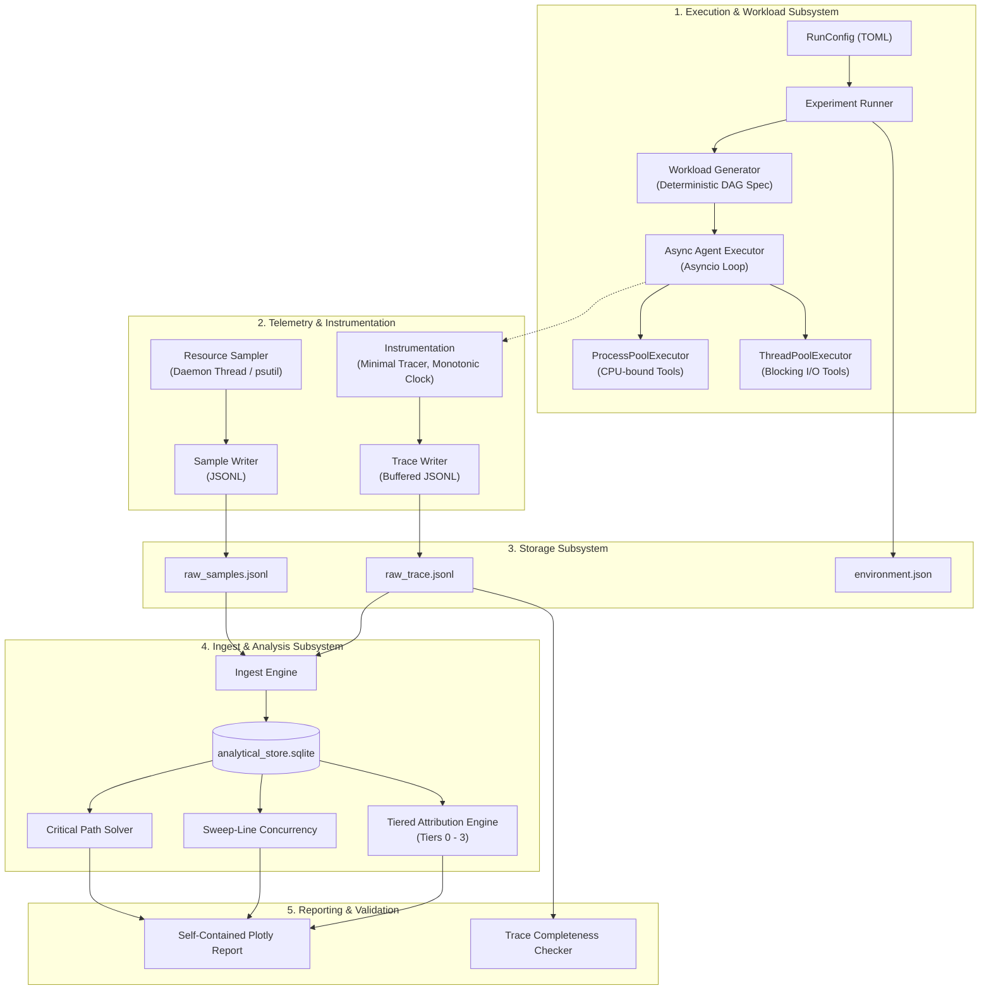

# AgentTrace: System Architecture

## 1. High-Level Architecture

AgentTrace decomposes into 5 primary subsystems designed for minimal runtime interference and strict reproducibility:

---

## 2. Component Breakdown

### 2.1 Experiment Runner & Workload Generator
- Reads declarative configuration via standard library `tomllib`.
- Creates an immutable DAG specification containing tasks, explicit parent-child relations, and `depends_on` constraints.
- Employs seed-derived per-task PRNG streams, ensuring that task parameters are independent of concurrent task scheduling order.

### 2.2 Async Agent Executor & Worker Pools
- Orchestrates asynchronous agent workflows with concurrency bounds managed via `asyncio.Semaphore`.
- Offloads CPU-intensive operations to dedicated child worker processes to prevent event-loop freezing.
- Executes blocking disk I/O in worker threads.

### 2.3 Instrumentation Subsystem
- Emits atomic `span_start` and `span_end` events.
- Captures nanosecond monotonic clock timestamps (`time.monotonic_ns()`) for every event.
- Provides a zero-overhead `NoOpTracer` arm for true baseline comparison.
- Sanitizes span attributes against an allowlist to guarantee zero secret leakage.

### 2.4 Resource Sampler Subsystem
- Runs as an independent background daemon thread.
- Samples process-tree CPU times, resident memory (RSS), context switches, and system metrics.
- Measures probe duration and jitter standard deviation on each tick.

### 2.5 Ingest, Correlation & Attribution
- Ingests append-only JSONL files into structured SQLite tables.
- Joins spans with resource samples via temporal intersection.
- Assigns attribution confidence labels (Tier 0 Context, Tier 1 Exclusive Window, Tier 2 Direct Process, Tier 3 Unsplit Aggregate).
- Computes exact concurrency using sweep-line algorithms.
